<div align="center">
  <picture>
    
  </picture>
  <h3>Distributed inference for diffusion transformers</h3>
  <a href="https://xdit-project.github.io/xDiT/">Documentation site</a> · <a href="#QuickStart">Quick start</a> · <a href="docs/runner/models.md">Supported models</a> · <a href="https://github.com/xdit-project/xDiT/discussions">Discussions</a> · <a href="#cite-us">Papers</a>

[](https://discord.gg/YEWzWfCF9S)

</div>

<h2 id="meet-xdit">xDiT</h2>

xDiT runs image, video, and audiovisual diffusion models on one or more devices.
The `xdit` CLI selects a model, configures parallel execution, and saves generated
outputs and measurements. Features vary by model and hardware; start with the
[supported-model and capability tables](docs/runner/models.md).

[](docs/assets/xdit-overview.svg)

<h2 id="QuickStart">Quick start</h2>

<a id="1-install-from-pip"></a><a id="2-install-from-source"></a><a id="3-docker"></a><a id="7-limitations"></a><a id="diffusers-version"></a>

### Install

Install PyTorch for your device, then install xDiT:

```bash
pip install xfuser
# Optional: Cache-DiT caching and TorchAO quantization
pip install "xfuser[cache-dit,torchao]"
```

The base package includes DistVAE and Yunchang. Some models require newer
Diffusers or Transformers than the package minimum. See the
[installation guide](docs/runner/installation.md) for source builds, optional
packages, and CUDA, ROCm, and Ascend containers.

<a id="4-usage"></a><a id="using-model-runner"></a><a id="support-dits"></a>

### Run a model

Choose a model from the [supported-model list](docs/runner/models.md). This example
uses FLUX.1-dev on one GPU with enough memory for its weights:

```bash
xdit --model FLUX.1-dev --prompt "A cat running in a garden"
```

Accept the checkpoint's license and authenticate with Hugging Face if required.
The first run downloads the weights. To distribute attention across eight GPUs:

```bash
xdit --model FLUX.1-dev --ulysses_degree 8 \
    --prompt "A cat running in a garden"
```

The launcher infers the process count from the parallel degrees. See
[launching](docs/runner/launching.md), [legacy pipeline examples](docs/runner/examples.md#dedicated-pipeline-examples),
and the [CLI reference](docs/runner/cli.md) for other workflows and options.

<h2 id="secrets">Choose capabilities</h2>

<a id="parallel"></a><a id="meet-xdit-parallel"></a><a id="USP"></a><a id="hybrid_parallel"></a><a id="PipeFusion"></a><a id="cfg_parallel"></a><a id="parallel_vae"></a>

| Goal | Guide |
| --- | --- |
| Scale inference across GPUs | [Ulysses and Ring](docs/methods/usp.md), [hybrid layouts](docs/methods/hybrid.md) |
| Fit models and high-resolution outputs in memory | [Sharding and offload](docs/runner/memory.md), [parallel VAE](docs/methods/parallel_vae.md) |
| Tune kernels, compute, and communication | [Attention](docs/runner/attention.md), [quantization](docs/runner/quantization.md), [communication](docs/runner/communication.md) |
| Reuse denoising work | [Caching](docs/runner/caching.md) |
| Adapt, measure, compile, and profile | [LoRA](docs/runner/lora.md), [benchmarking](docs/runner/benchmarking.md) |

<a id="1gpuacc"></a><a id="compilation"></a><a id="cache_acceleration"></a><a id="meet-xdit-cache"></a><a id="meet-xdit-perf"></a><a id="6-supported-attention-backends"></a>

Check the [model capability matrix](docs/runner/models.md) before combining
features. Quantization, caching, and reduced-precision communication can change
output quality; compare results on your workload.

<h2 id="comfyui">Integrations and resources</h2>

<a id="using-example-scripts"></a>

- [xDiT ComfyUI](https://github.com/xdit-project/xdit-comfyui): model loading and generation through ComfyUI.
- [Legacy model examples](docs/runner/examples.md#dedicated-pipeline-examples).
- [External model integrations](docs/runner/examples.md#external-model-integrations): StepVideo and Mochi use separate launchers.
- [Container builds and workload configurations](https://github.com/AMD-AGI/diffusion-models-inference): CUDA, Instinct, and RDNA 4 environments.
- [Community resources](docs/resources.md), including Google Cloud serving and ROCm recipes.

<h2 id="dev-guide">Contribute</h2>

<a id="updates"></a><a id="agenda"></a>

Start with [adding a model](docs/developer/adding_models/readme.md) and
[framework design](docs/developer/The_implement_design_of_xdit_framework.md).
Use [discussions](https://github.com/xdit-project/xDiT/discussions) for questions
and [issues](https://github.com/xdit-project/xDiT/issues) for reproducible problems.

<h2 id="cite-us">📝 Cite Us</h2>

[xDiT: an Inference Engine for Diffusion Transformers (DiTs) with Massive Parallelism](https://arxiv.org/abs/2411.01738)

```bibtex
@article{fang2024xdit,
  title={xDiT: an Inference Engine for Diffusion Transformers (DiTs) with Massive Parallelism},
  author={Fang, Jiarui and Pan, Jinzhe and Sun, Xibo and Li, Aoyu and Wang, Jiannan},
  journal={arXiv preprint arXiv:2411.01738},
  year={2024}
}

```

[PipeFusion: Patch-level Pipeline Parallelism for Diffusion Transformers Inference](https://openreview.net/forum?id=5xwyxupsLL)

```bibtex
@inproceedings{
    fang2025pipefusion,
    title={PipeFusion: Patch-level Pipeline Parallelism for Diffusion Transformers Inference},
    author={Jiarui Fang and Jinzhe Pan and Aoyu Li and Xibo Sun and WANG Jiannan},
    booktitle={The Thirty-ninth Annual Conference on Neural Information Processing Systems},
    year={2025},
    url={https://openreview.net/forum?id=5xwyxupsLL}
}

```

[USP: A Unified Sequence Parallelism Approach for Long Context Generative AI](https://arxiv.org/abs/2405.07719)

```bibtex
@article{fang2024unified,
  title={A Unified Sequence Parallelism Approach for Long Context Generative AI},
  author={Fang, Jiarui and Zhao, Shangchun},
  journal={arXiv preprint arXiv:2405.07719},
  year={2024}
}

```

[Unveiling Redundancy in Diffusion Transformers (DiTs): A Systematic Study](https://arxiv.org/abs/2411.13588)

```bibtex
@article{sun2024unveiling,
  title={Unveiling Redundancy in Diffusion Transformers (DiTs): A Systematic Study},
  author={Sun, Xibo and Fang, Jiarui and Li, Aoyu and Pan, Jinzhe},
  journal={arXiv preprint arXiv:2411.13588},
  year={2024}
}

```
