# CFG parallelism

[中文](cfg_parallel_zh.md)

Classifier-free guidance (CFG) combines positive and negative prompt predictions.
`--use_cfg_parallel` assigns ranks to two prediction branches, then gathers their
predictions before guidance and the scheduler step. Its degree is fixed at 2.

[](../assets/cfg-parallel.svg)

Z-Image supports CFG parallelism and defaults to guidance scale 4:

```bash
xdit --model Z-Image --use_cfg_parallel \
    --prompt "A cat running in a garden"
```

This command launches two ranks. For eight ranks, add `--ulysses_degree 4`.
Each branch then uses four sequence-parallel ranks. See [hybrid layouts](hybrid.md) and the
[model capability matrix](../runner/models.md) for supported combinations.

Use CFG parallelism only while both prediction branches are active.
Z-Image requires Diffusers 0.36 or newer. Z-Image-Turbo does not support CFG
parallelism and disables CFG by default. FLUX.1-dev uses a guidance embedding
instead of two branches and does not support CFG parallelism.

Ordinary CFG also works on one rank. Parallelism benefits depend on the workload
and communication cost.
