# CFG 并行

[English](cfg_parallel.md)

无分类器引导（CFG）组合正向和负向提示词的预测结果。
`--use_cfg_parallel` 将 rank 分配到两个预测分支，收集预测后再执行
引导运算和 scheduler 更新。CFG 并行度固定为 2。

[](../assets/cfg-parallel.svg)

Z-Image 支持 CFG 并行，默认 guidance scale 为 4：

```bash
xdit --model Z-Image --use_cfg_parallel \
    --prompt "A cat running in a garden"
```

此命令启动两个 rank。添加 `--ulysses_degree 4` 后启动八个 rank，
每个 CFG 分支使用四个序列并行 rank。支持的组合见
[混合并行布局](hybrid.md)和[模型能力表](../runner/models.md)。

只有两个预测分支都启用时，才应使用 CFG 并行。Z-Image-Turbo 和
FLUX.1-dev 不支持此选项：Turbo 默认关闭 CFG，FLUX 则使用 guidance
embedding，而不是两个独立分支。单个 rank 也可以执行普通 CFG；并行收益
取决于工作负载和通信成本。Z-Image 需要 Diffusers 0.36 或更新版本。
