# Hybrid parallelism

[中文](./hybrid_zh.md)

For models that support multiple parallel methods, xDiT can combine them.
Choose a layout for the model, available memory, and device interconnect.
Measure the workload: each additional device adds communication and synchronization.

| Method | What is distributed | Runner option |
| --- | --- | --- |
| Data parallelism | Independent prompts across model groups | `--data_parallel_degree` |
| CFG parallelism | Conditional and unconditional predictions | `--use_cfg_parallel` (degree 2) |
| Ulysses | Attention tokens and heads through all-to-all exchanges | `--ulysses_degree` |
| Ring | Attention KV blocks through ring communication | `--ring_degree` |
| PipeFusion | Transformer stages processing latent patches | `--pipefusion_parallel_degree` |
| Tensor parallelism | Supported transformer computations | `--tensor_parallel_degree` |

[](../assets/parallel-layout.svg)

## Configure the ranks

The launcher rank count is the product of data, CFG, Ulysses, Ring, transformer
tensor parallelism, and PipeFusion degrees. Unused degrees are 1. For example,
this layout uses eight devices: two CFG branches, each with four Ulysses ranks.

```bash
xdit --model Z-Image \
    --prompt "A cat running in a garden" \
    --use_cfg_parallel --ulysses_degree 4
```

Z-Image's default guidance is active. Ulysses exchanges occur inside each branch.
CFG groups pair corresponding ranks across branches and gather their predictions. Ring and PipeFusion
degrees are 1 in this example. CFG adds a factor of 2 for supported, active branches.
`--fully_shard_degree` and `--text_encoder_tp_degree` reuse existing model ranks.
They do not add launcher processes. See the [runner launch guide](../runner/runner.md#launch-and-parallel-configuration)
for multi-node launch and FSDP constraints.

### Choose the next guide

- [USP](usp.md): attention-head and backend constraints for Ulysses and Ring.
- [PipeFusion](pipefusion.md): stage balance, patch counts, and composition limits.
- [CFG parallelism](cfg_parallel.md): split active conditional and unconditional branches.
- [Parallel VAE](parallel_vae.md): distribute VAE work after transformer denoising.

FSDP shards selected component weights over existing ranks. Transformer tensor
parallelism splits supported transformer computations. Both require model support.
The VAE has its own schedule and does not follow the transformer patch pipeline.
