# 混合并行

[English Version](./hybrid.md)

在模型支持的前提下，xDiT 可以组合不同的并行方式。应根据模型、可用显存和
设备互联选择布局，并实际测量任务：增加设备也会增加通信和同步开销。

| 并行方式 | 分配的工作 | 运行器参数 |
| --- | --- | --- |
| 数据并行 | 将独立提示词分配到不同模型组 | `--data_parallel_degree` |
| CFG 并行 | 条件与无条件预测分支 | `--use_cfg_parallel`，并行度为 2 |
| Ulysses | 通过 all-to-all 交换注意力 token 与 head | `--ulysses_degree` |
| Ring | 通过环形通信传递注意力 KV 块 | `--ring_degree` |
| PipeFusion | Transformer 阶段处理 latent patch | `--pipefusion_parallel_degree` |
| 张量并行 | 支持的 Transformer 计算 | `--tensor_parallel_degree` |

[](../assets/parallel-layout.svg)

## 配置 rank 数量

启动进程数为数据、CFG、Ulysses、Ring、Transformer 张量并行和 PipeFusion
并行度的乘积。未使用的并行度为 1。以下示例使用八个设备：两个 CFG
分支，每个分支包含四个 Ulysses rank。

```bash
xdit --model Z-Image \
    --prompt "A cat running in a garden" \
    --use_cfg_parallel --ulysses_degree 4
```

Z-Image 默认启用引导。Ulysses 在各分支内部交换 token 和 head；CFG
在对应 rank 间收集预测。此示例的 Ring 和 PipeFusion 并行度均为 1。
只有模型支持且生成设置启用了 CFG 时，CFG 并行才额外引入 2 倍的 rank 数。
`--fully_shard_degree` 和 `--text_encoder_tp_degree` 复用已有模型 rank，
不会增加启动进程数。多节点启动和 FSDP 限制见[运行器启动指南](../runner/runner.md#launch-and-parallel-configuration)。

### 选择下一篇指南

- [USP](usp.md)：Ulysses 和 Ring 的注意力 head 与后端限制。
- [PipeFusion](pipefusion.md)：阶段负载、patch 数和组合限制。
- [CFG 并行](cfg_parallel_zh.md)：拆分已启用的条件与无条件分支。
- [并行 VAE](parallel_vae.md)：在 Transformer 去噪后分配 VAE 工作。

FSDP 在已有 rank 上分片指定组件的权重；Transformer 张量并行拆分支持的
Transformer 计算。两者均要求模型支持。VAE 使用独立调度，不遵循
Transformer 的 patch 流水线。
