<a id="patch-parallel-vae"></a>

# Parallel VAE

The VAE converts between images or video and model latents. Its activations can
be a memory bottleneck at high resolution. xDiT uses
[DistVAE](https://github.com/xdit-project/DistVAE) to distribute supported VAEs.

## Start with row sharding

With tiling disabled and a supported VAE, **`--use_parallel_vae` enables row
sharding**. Supported decoder layers process local rows. Convolutions exchange
boundary rows. GroupNorm shares statistics where required.

Some work remains replicated. The 2D adapter starts sharding after the input
convolution and mid-block. Row sharding aims to reduce activation memory while
matching unsharded decoding within numerical tolerance.

```bash
xdit --model FLUX.1-dev \
    --prompt "A spectacular sunset over the ocean" \
    --ulysses_degree 2 --use_parallel_vae
```

This uses two ranks for both transformer sequence parallelism and VAE decoding.
The runner reuses tensor, sequence, pipeline, and CFG ranks within each data-parallel
group. The flag does not add ranks. For models with parallel encoding support,
the same flag also distributes encoding. There is no separate encoder CLI flag.

[](../assets/parallel-vae.svg)

## Enable tiling when needed

Tiling is a separate memory option, useful on one GPU as well as with parallel
VAE. It decodes overlapping spatial windows instead of the full image or frame.

| Options | Decode path |
| --- | --- |
| `--use_parallel_vae` | Row sharding when tiling is disabled and the VAE supports row adapters. |
| `--enable_tiling` | Local tiled decoding, subject to the VAE's tiling threshold. |
| Both | Whole tiles are assigned to ranks when the VAE has a supported tile adapter; otherwise supported decoders shard rows within each tile. |
| `--enable_slicing` | Slice the batch where supported. This is independent of spatial tiling. |

Whole-tile distribution avoids per-layer row exchange. Overlapping tiles repeat
some decoder work. Tile-local normalization and blending can change the output.
Memory use depends mainly on the tile window, rather than the rank count.
If there are fewer tiles than ranks, DistVAE falls back to decoding the full tile
grid locally on every rank. Smaller tiles do not always reduce peak memory,
especially for video VAEs with temporal state outside the spatial window.

MiniMax-H3 uses native tile dispatch instead of DistVAE row adapters. LTX-2's
diffusion decoder enables native tiling with parallel VAE. Some pipelines enable
VAE tiling during loading. These pipelines use tiling without an explicit
`--enable_tiling` flag.

## Set an exact tile window

| Options | Units and requirements |
| --- | --- |
| `--vae_tile_size_height`, `--vae_tile_size_width` | Positive output-pixel dimensions; supply both with `--enable_tiling`. |
| `--vae_tile_overlap_height`, `--vae_tile_overlap_width` | Non-negative output-pixel overlap; supply both with `--enable_tiling`. Use zero on an axis that spans the output without tiling. |

The window and overlap must map exactly to the VAE's latent scale and strides.
xDiT rejects unsupported geometry. Clipped edge tiles must also be large enough
for decoder padding. Row sharding needs a valid split with at least one latent row per rank.
Whole-tile dispatch does not have this row-split requirement.

For example, this two-device FLUX.2 Klein configuration uses full-width strips:

```bash
xdit --model black-forest-labs/FLUX.2-klein-4B \
    --prompt "A spectacular sunset over the ocean" \
    --height 2048 --width 2048 \
    --num_inference_steps 4 --guidance_scale 1.0 \
    --ulysses_degree 2 \
    --use_parallel_vae --enable_tiling \
    --vae_tile_size_height 352 --vae_tile_size_width 2048 \
    --vae_tile_overlap_height 88 --vae_tile_overlap_width 0
```

The geometry comes from [AMD's RDNA 4 recipe](https://github.com/AMD-AGI/diffusion-models-inference/blob/13fbb792d3c447e7356114ad219940f5b337c778/benchmark_configs/xdit/flux2_klein.yaml#L139-L163).
Its additional precision, attention, and loading settings require the matching
hardware and software environment.

Compare row sharding, tiling, and unsharded decoding on your workload with fixed
seeds. Measure end-to-end peak memory and latency. Inspect output quality.
VAE weights and final output assembly still consume memory on each rank.
DistVAE's [decode strategy guide](https://github.com/xdit-project/DistVAE/blob/main/docs/strategies.md)
and [tile-window guide](https://github.com/xdit-project/DistVAE/blob/main/docs/tiling.md)
explain the family-specific tradeoffs. See the [runner guide](../runner/runner.md)
for model support. The `xdit` CLI uses existing model ranks for parallel VAE.
