# PipeFusion

PipeFusion splits transformer blocks into stages on different GPUs. Latent patches
pass through these stages. Attention retains previous-step KV entries until each
patch is updated. Stage partitioning reduces the transformer weights on each GPU.
KV reuse can change the generated output.

## Start with two stages

The unified runner supports PipeFusion for selected models, including FLUX.1-dev.
This command launches two ranks:

```bash
xdit --model FLUX.1-dev \
    --prompt "A cat running in a garden" \
    --pipefusion_parallel_degree 2
```

This example defaults to two patches and one synchronous denoising step to initialize
attention KV caches. Compare its output and latency with `--pipefusion_parallel_degree 1`.
Tune the layout if the workload benefits.

[](../assets/pipefusion.svg)

## Tune the layout

| Option | Use |
| --- | --- |
| `--pipefusion_parallel_degree N` | Set the stage count. `1` disables PipeFusion. |
| `--num_pipeline_patch N` | Set the number of latent patches; defaults to the stage count. More patches can improve overlap but add overhead. |
| `--warmup_steps N` | Run this many synchronous denoising steps before patch updates. Must be at least `1`. Increase it if the initial patch updates affect output quality. |
| `--attn_layer_num_for_pp N …` | Override the layer split with one positive count per stage. Counts must cover all transformer blocks and respect the model's stage boundaries. |

Patch and stage counts can differ. The output dimensions must permit the model's
patch layout. `--warmup_steps` counts denoising steps within a generation.
`--warmup_calls` counts complete, untimed generations before a benchmark.

<a id="composition-and-validation-boundaries"></a>

## Combine with other options

| Option | Constraint |
| --- | --- |
| Ulysses, Ring, or CFG parallelism | Require model support and multiply the rank count. See [hybrid parallelism](hybrid.md). |
| Parallel VAE | Uses a separate VAE decode schedule over the existing ranks. See [Parallel VAE](parallel_vae.md). |
| Step caching | Use `--cache_method pipefusion` on a model with a supported DBCache layout. Other cache methods are rejected; data parallelism must remain `1`. Caching adds another approximation to check for output quality. |
| `--memory_efficient_replicated_load` | On supported FLUX runners, load only each stage's transformer blocks. Availability depends on the model; SD3.5 rejects this option with PipeFusion. |
| FSDP | Select replicated components explicitly with `--fully_shard_components`. The stage-local transformer cannot be FSDP-wrapped. |
| `--use_torch_compile` | Supported stage wrappers capture and compile their local calls during runner warmup. Allow for compilation startup before measuring inference. |
| LoRA | Startup LoRA fusion currently rejects PipeFusion. |

Ascend NPU currently does not support PipeFusion. Backend availability and model
capability checks also apply; consult the [runner guide](../runner/runner.md) and
[CLI reference](../runner/cli.md) for supported launch and loading options.

Use fixed seeds and representative prompts when checking output quality. Stage balance, communication,
and the number of denoising steps affect latency. More stages or patches do not
guarantee a faster run.

For the method, see the [PipeFusion paper](https://openreview.net/forum?id=5xwyxupsLL).
Implementation entry points are the [stage split](https://github.com/xdit-project/xDiT/blob/main/xfuser/model_executor/models/transformers/base_transformer.py),
[patch schedules](https://github.com/xdit-project/xDiT/tree/main/xfuser/model_executor/pipefusion/schedules),
and [compile warmup](https://github.com/xdit-project/xDiT/blob/main/xfuser/model_executor/pipefusion/compile.py).
