# Unified sequence parallelism (USP)

Use Ulysses, Ring, or both. Their product is the sequence-parallel degree:
`ulysses_degree × ring_degree`. Set an unused degree to 1.

[](../assets/usp.svg)

| Option | Communication and constraints |
| --- | --- |
| `--ulysses_degree` | All-to-all exchanges redistribute attention tokens and heads. The degree must divide query and KV head counts unless the model supports head padding. |
| `--ring_degree` | Ring ranks exchange KV blocks while accumulating attention. Availability depends on the model and selected attention backend. |
| `--attention_backend` | Select the attention kernel. Model capabilities, device architecture, head shape, and installed packages restrict the choices. |
| `--use_fp8_comms` | Quantize supported Ulysses exchanges; it does not quantize model weights or every collective. Requires a supported model/backend combination and can change output. |

With both methods, the sequence-parallel degree can exceed the head count, provided
the Ulysses degree remains valid. Attention size and interconnect determine whether
communication costs outweigh the saved compute time. More ranks do not guarantee
lower latency.

Sequence parallelism divides attention work. For weight memory limits, combine it
with supported [FSDP or PipeFusion](hybrid.md) layouts.

```bash
xdit --model FLUX.1-dev \
    --prompt "A cat running in a garden" \
    --ulysses_degree 2 --ring_degree 2
```

Before running this four-rank example, check that your attention backend supports Ring. xDiT's `USP` implementation integrates attention backends,
Ulysses exchanges, Ring communication, and the patch-aware KV cache needed by
[PipeFusion](pipefusion.md). Causal attention and joint text/image
layouts depend on the model.
For supported FP8 exchanges, see [communication options](../runner/communication.md).
See the [runner launch guide](../runner/launching.md)
and [CLI reference](../runner/cli.md) for current flags and backend choices.

The current implementation is [in-tree USP](https://github.com/xdit-project/xDiT/blob/main/xfuser/model_executor/layers/usp.py).
For the method, see the [USP paper](https://arxiv.org/abs/2405.07719).
